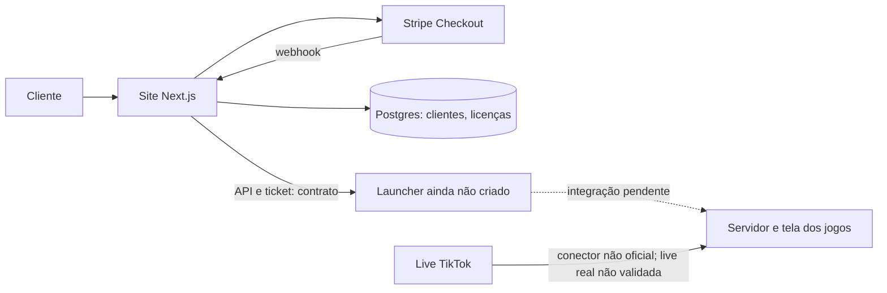

# santi.hub — documentação de arquitetura

Estudo de caso do santi.hub: um site de planos e licenças para jogos interativos de live, com um protótipo de servidor e tela de jogo em tempo real. Este repositório contém **somente documentação**. O código analisado permanece em repositórios privados.

## Estado verificado

| Parte | Estado | Evidência |
| --- | --- | --- |
| Site, checkout, autenticação e API de licenças | Implementados no código; publicação informada pelo autor, sem verificação operacional neste estudo | `santi-hub` no commit `97ee1f200461bc575f524df66ef363cc9c9e2e8d` |
| Servidor, simulador e tela dos jogos | Implementados; teste ponta a ponta com simulador descrito no repositório | `live-jogos` no commit `7e65efb42702b5918d499a85a58c9751de997948` |
| Integração com live real | Não validada na documentação do projeto | `live-jogos/ARQUITETURA.md` |
| Launcher Windows | Ainda não criado, conforme informado pelo autor | Contrato planejado em `santi-hub/docs/api-launcher.md` |
| Ligação entre licença do site e execução dos jogos | Ainda não implementada de ponta a ponta | Launcher ausente; servidor de jogos não consulta a API de licenças |

O conector atual dos jogos usa `tiktok-live-connector`, uma biblioteca **não oficial**. Essa limitação está descrita porque o uso de API oficial para conteúdo de usuários é um requisito do portfólio futuro; não há base para apresentar a coleta atual como aderente a ele.

## Leitura em 60 segundos

1. [Arquitetura](docs/arquitetura.md): limites dos componentes, caminho de um evento e falhas de conexão.
2. [Modelo de dados](docs/modelo-de-dados.md): tabelas persistidas e estado da partida.
3. [Fluxo de pagamento](docs/fluxo-pagamento.md): confirmação, idempotência, licença e falha do webhook.
4. [Decisões arquiteturais](docs/adr/): escolhas presentes no código, alternativas e consequências.

## Como conferir

Os documentos citam caminhos e commits dos dois repositórios privados usados na leitura. Não há comandos de execução neste repositório porque ele não contém o produto. Não há métricas de tráfego, latência, receita ou disponibilidade medidas; qualquer número de operação permanece **[A MEDIR]**.

## Limites conhecidos

- O simulador demonstra o fluxo dos jogos, mas não comprova operação numa live real.
- Sem launcher, o ticket de licença e o servidor dos jogos ainda não formam uma liberação de acesso ponta a ponta.
- O estado da rodada fica no navegador; uma recarga não restaura a rodada em curso.
- O conector de TikTok atual não usa API oficial. Uma integração pública baseada em conteúdo de usuários depende de fonte oficial e dos respectivos termos de uso.

## Licença

Texto e diagramas sob [MIT](LICENSE). Nenhum código-fonte, segredo ou dado de cliente é distribuído aqui.
