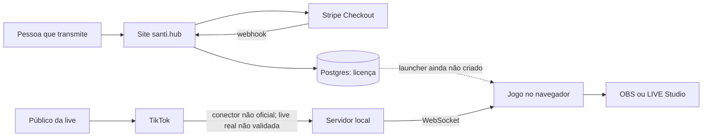
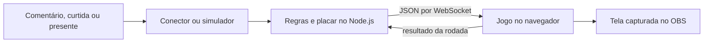
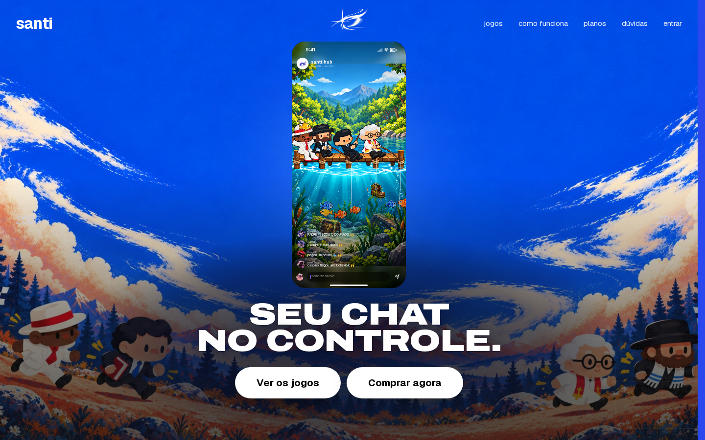
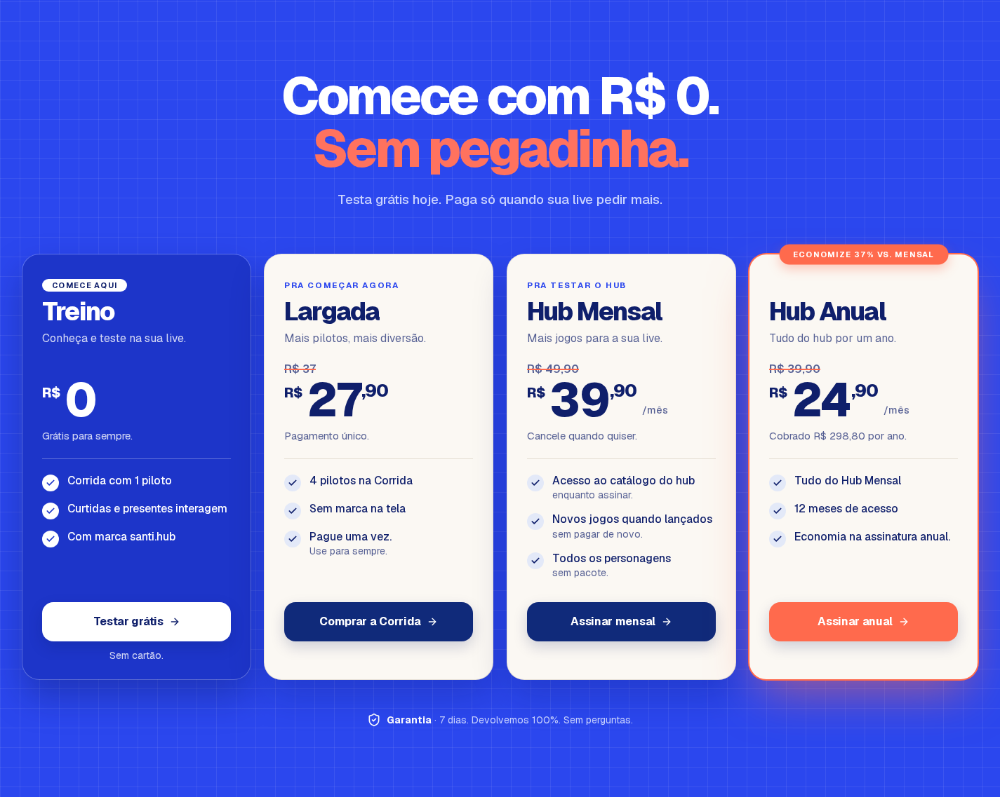
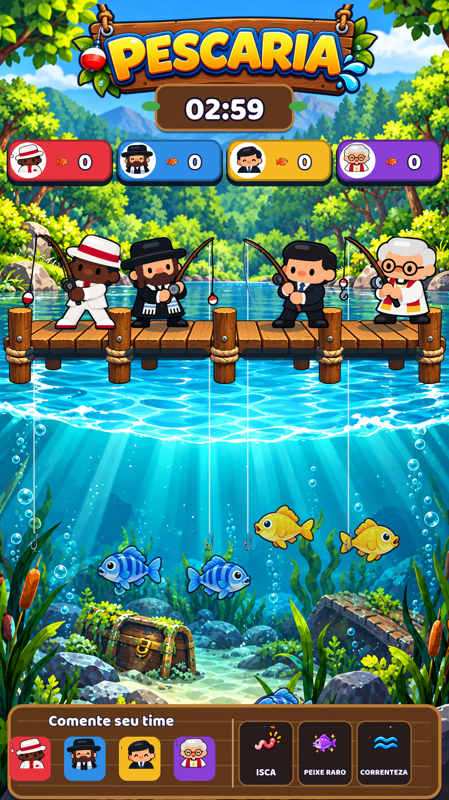

# santi.hub — como o produto funciona

**Site publicado: [santiestudio.com.br](https://santiestudio.com.br)** · [Ver planos](https://santiestudio.com.br/#planos) · [Arquitetura detalhada](docs/arquitetura.md)

O **santi.hub** reúne planos, cobrança e licenças com jogos que o público controla durante uma live. Quem transmite coloca a tela do jogo no OBS ou LIVE Studio; quem assiste comenta, curte ou envia presentes para interferir na partida.

## Arquitetura em um olhar

**O caminho de uma jogada:**

## O produto em imagens

**Página inicial publicada.** Clique na captura para abrir o site.

**Planos mostrados no site em 23/10/2026.** Os preços podem mudar; confira os [planos atuais](https://santiestudio.com.br/#planos).

**Tela da Pescaria no simulador.** É uma captura do jogo, não evidência de uma live real.

[Origem das imagens](docs/imagens/ORIGEM.md)

## Como a pessoa usa

Para quem transmite, o fluxo começa na página de planos. O site envia a compra para a Stripe; um webhook confirmado grava a licença no Postgres, e a API calcula o acesso. **Esse acesso ainda não é aplicado ao jogo:** a API emite um ticket, mas o launcher Windows que o consumiria ainda não foi criado.

Durante a transmissão, o jogo alterna entre **Batata Quente, Domina o Mapa, Pescaria e Corrida**. Comentar o nome de um time já conta como jogada; curtidas e presentes ajudam o último time escolhido. O narrador pode avançar ou pausar. O resultado de cada rodada alimenta o placar geral, mostrado na tela capturada pelo OBS.

## O que está neste repositório

Este é um **repositório público só de documentação**. O código analisado permanece nos repositórios privados `santi-hub` (site, cobrança, autenticação e API) e `live-jogos` (servidor, simulador e tela). A análise usa, respectivamente, os commits `97ee1f200461bc575f524df66ef363cc9c9e2e8d` e `7e65efb42702b5918d499a85a58c9751de997948`.

- [Arquitetura](docs/arquitetura.md): visão do sistema, contêineres, exemplo de evento, estados e reconexão.
- [Modelo de dados](docs/modelo-de-dados.md): tabelas do site e dados da partida fora do banco.
- [Fluxo de pagamento](docs/fluxo-pagamento.md): confirmação, licença, falha e reenvio do webhook.
- [Decisões arquiteturais](docs/adr/): cinco ADRs ligados ao que foi observado no código.

## Estado e limites

| Parte | Evidência disponível | Limite |
| --- | --- | --- |
| Site, checkout, autenticação e API de licenças | Implementados em `santi-hub`; página pública capturada em 23/10/2026 | Operação de pagamento real não verificada neste estudo |
| Servidor e tela dos jogos | Código e testes do simulador em `live-jogos` | Live real não validada na documentação do projeto |
| Controle de acesso ao jogo | API emite ticket assinado | Launcher não criado; servidor dos jogos não verifica licença |
| Coleta de eventos TikTok | Conector no código dos jogos | Usa `tiktok-live-connector`, biblioteca **não oficial** |

O conector atual não atende ao requisito futuro do portfólio de coletar conteúdo de usuários apenas por API oficial. Não há métricas medidas de tráfego, receita, latência ou disponibilidade: **[A MEDIR]**.

## Como conferir

Os documentos citam caminhos dos dois repositórios privados e os commits usados na leitura. Este repositório não contém código executável, credenciais ou dados de clientes. Texto e diagramas estão sob [MIT](LICENSE).
