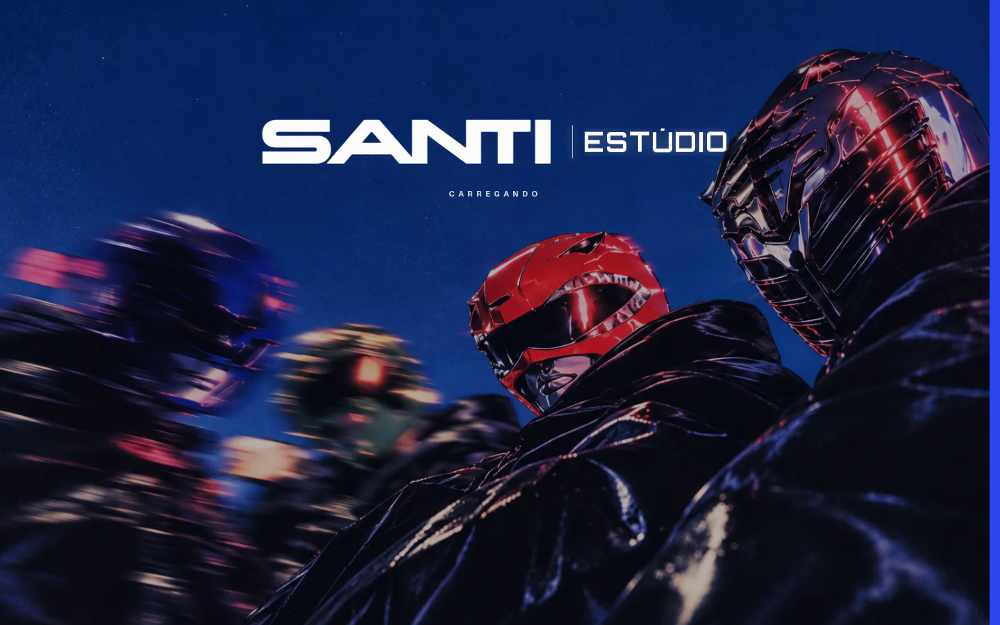
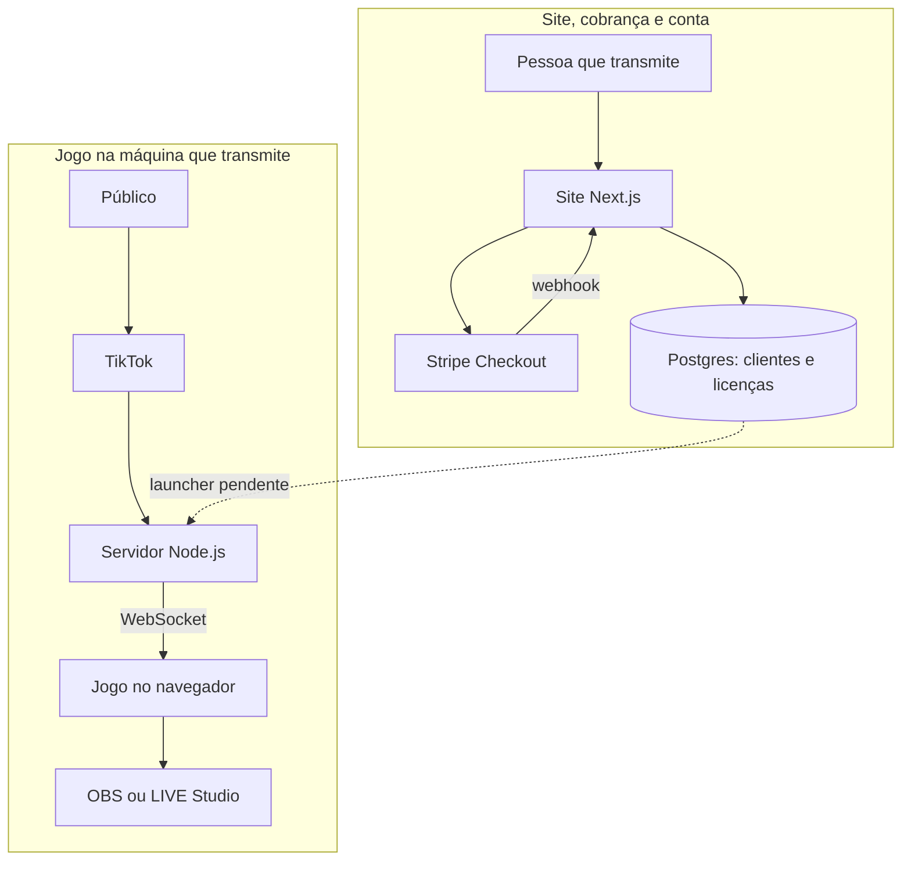
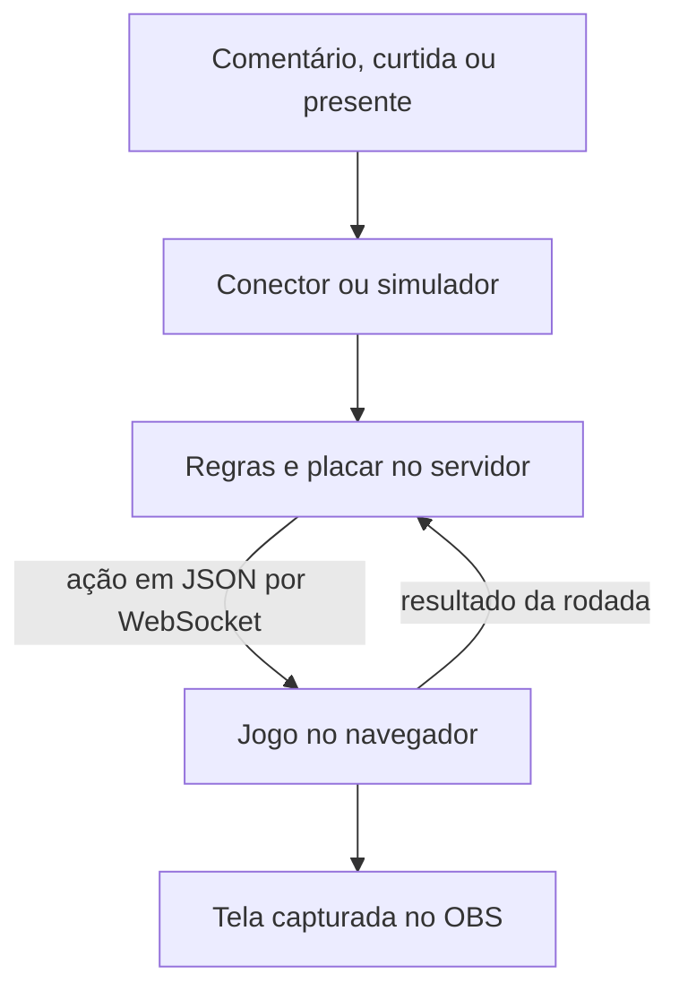
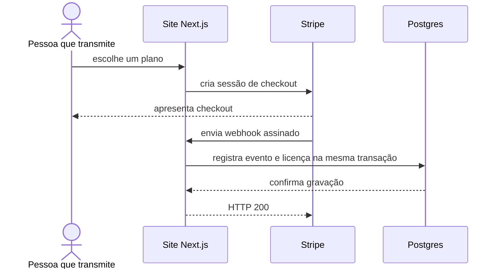
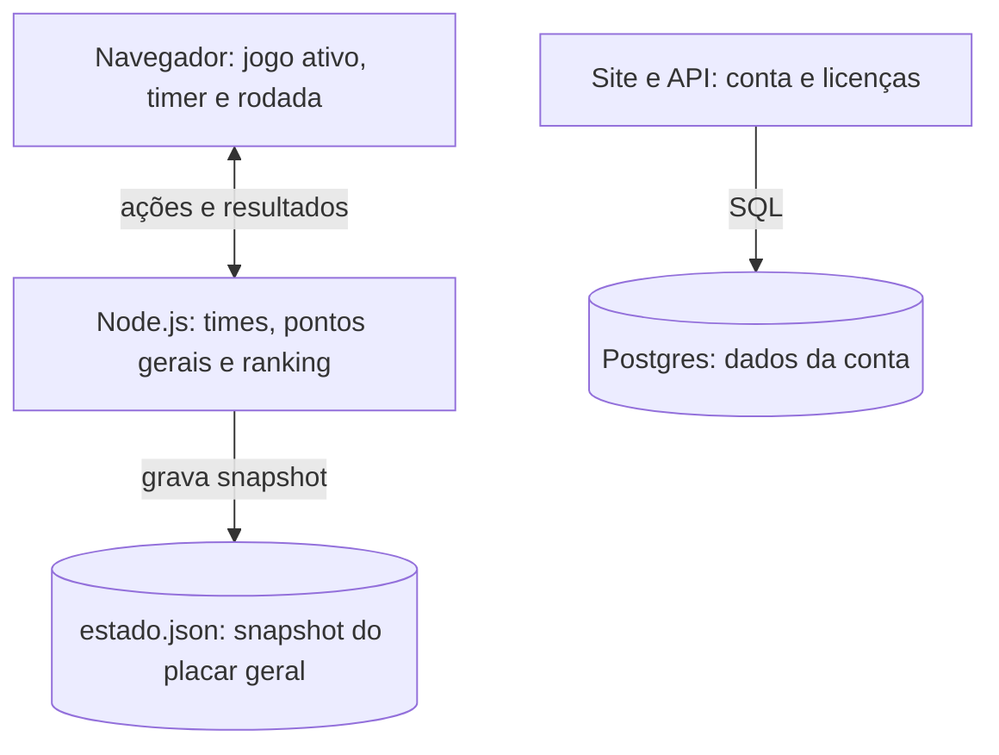

# santi.hub

  <strong>Jogos interativos para lives do TikTok</strong> 
  O público participa com comentários, curtidas e presentes.  
  <a href="https://santiestudio.com.br"><strong>Acessar o site</strong></a> ·
  <a href="https://santiestudio.com.br/#jogos">Ver os jogos</a> ·
  <a href="https://santiestudio.com.br/#planos">Ver os planos</a>

 

Este repositório público apresenta o santi.hub por meio de **capturas e documentação**. O código do site e o código dos jogos ficam em repositórios privados separados. O site reúne planos, cobrança e conta; o servidor local recebe interações da live e as envia ao jogo exibido no OBS ou LIVE Studio.

## Telas do produto

**Abertura do site.** Captura da animação de loading publicada em 23/10/2026.

**Catálogo de jogos.** A página mostra Corrida como disponível e identifica os outros jogos como próximos lançamentos.

## Índice

- [Sobre o projeto](#sobre-o-projeto)
- [Funcionalidades](#funcionalidades)
- [Arquitetura](#arquitetura)
- [Tecnologias](#tecnologias)
- [Estado atual](#estado-atual)
- [Documentação](#documentação)
- [Autor e licença](#autor-e-licença)

## Sobre o projeto

Quem transmite escolhe um plano no site e pode consultar sua conta. A confirmação de pagamento chega por webhook e grava uma licença no Postgres. A API já calcula o acesso e emite um ticket assinado, mas o launcher Windows que ligaria esse acesso à execução do jogo ainda não foi criado.

No jogo, comentar o nome de um time conta como jogada. Curtidas e presentes ajudam o último time escolhido. O servidor interpreta os eventos e envia ações por WebSocket ao navegador capturado pelo OBS. O simulador permite testar esse fluxo sem uma live.

## Funcionalidades

| Área | O que o código faz |
| --- | --- |
| Planos e checkout | O site calcula o preço no servidor e abre uma sessão Stripe Checkout. |
| Conta e licença | O webhook assinado grava a licença; a API calcula o acesso disponível e pode emitir um ticket assinado. |
| Interação | O servidor transforma comentários, curtidas e presentes em ações de jogo. O simulador percorre esse mesmo caminho. |
| Tela da partida | O navegador recebe ações por WebSocket, atualiza o minijogo e envia o resultado da rodada ao servidor. |
| Reconexão | O conector e o cliente WebSocket tentam restabelecer a conexão; ações perdidas durante a queda não são reproduzidas. |

## Arquitetura

### Componentes e integrações

A ligação pontilhada ainda não funciona de ponta a ponta. O launcher não existe. O conector de TikTok usa uma biblioteca não oficial, e o repositório dos jogos não registra validação numa live real.

### Interação do público até a tela

O servidor aplica as regras e envia a ação ao minijogo ativo. Quando a rodada termina, o navegador devolve o resultado e o servidor atualiza o placar geral.

### Compra até a licença

A página de retorno do checkout não libera o acesso. Se o webhook falhar durante a gravação, a rota responde 500 e a transação é desfeita. O [fluxo de pagamento](docs/fluxo-pagamento.md) detalha reenvio, idempotência e casos de pagamento pendente.

### Onde o estado fica

Na reconexão do WebSocket, a tela recebe o placar geral atual. As ações perdidas não são reenviadas, e uma recarga da página reinicia a rodada local. Veja os limites no [documento de arquitetura](docs/arquitetura.md).

## Tecnologias

| Parte | Tecnologia | Papel |
| --- | --- | --- |
| Site e API | Next.js, React e TypeScript | Páginas, conta, checkout e webhook |
| Dados da conta | PostgreSQL | Clientes, licenças, sessões e eventos Stripe |
| Pagamento | Stripe | Checkout, assinatura e avisos de pagamento |
| Servidor do jogo | Node.js e TypeScript | Interpretação dos eventos, placar e WebSocket |
| Tela do jogo | Phaser e TypeScript | Rodadas, interface e ações visíveis na transmissão |

## Estado atual

| Parte | Estado |
| --- | --- |
| Página pública | Acessível em [santiestudio.com.br](https://santiestudio.com.br) em 23/10/2026; teste de acesso: `curl -IL --max-time 15 https://santiestudio.com.br` |
| Servidor e tela dos jogos | Testados com o simulador; live real não validada na documentação do projeto |
| Launcher Windows | Ainda não criado |
| Liberação do jogo por licença | Ainda não implementada de ponta a ponta |
| Coleta de eventos TikTok | Conector atual usa `tiktok-live-connector`, biblioteca não oficial |

Tráfego, receita, latência e disponibilidade: **[A MEDIR]**. As capturas mostram telas reais, mas não comprovam pagamento concluído nem uso numa live real.

## Documentação

- [Arquitetura](docs/arquitetura.md): componentes, caminho de um evento, estados e reconexão.
- [Modelo de dados](docs/modelo-de-dados.md): tabelas do site e estado dos jogos fora do banco.
- [Fluxo de pagamento](docs/fluxo-pagamento.md): checkout, webhook, licença e falhas.
- [Decisões arquiteturais](docs/adr/): escolhas e consequências observadas no código.

## Autor e licença

[Matheus Guilherme](https://github.com/theuzao). A documentação está sob a [licença MIT](LICENSE).
