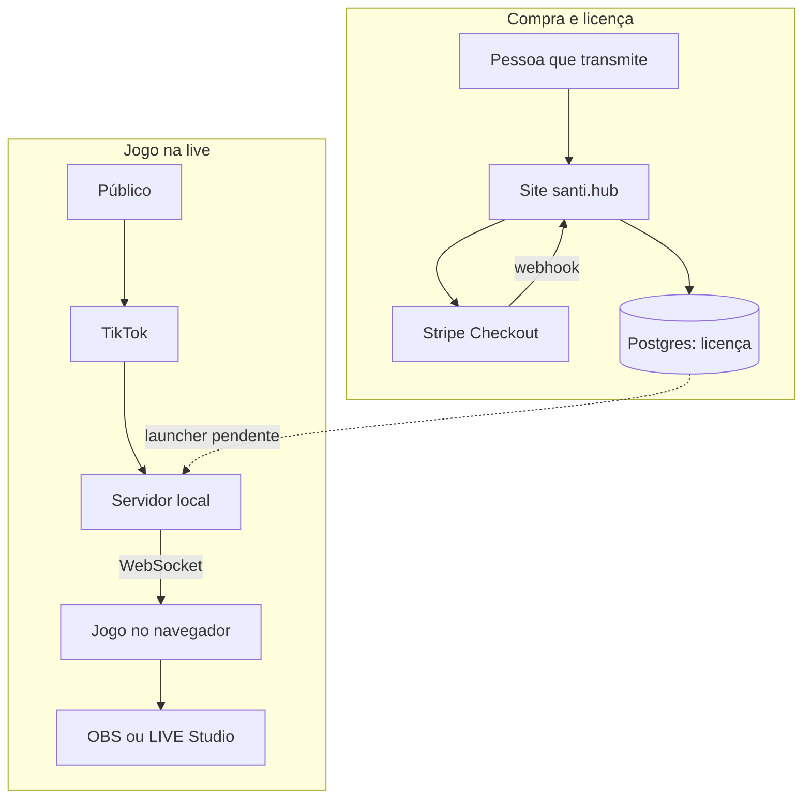
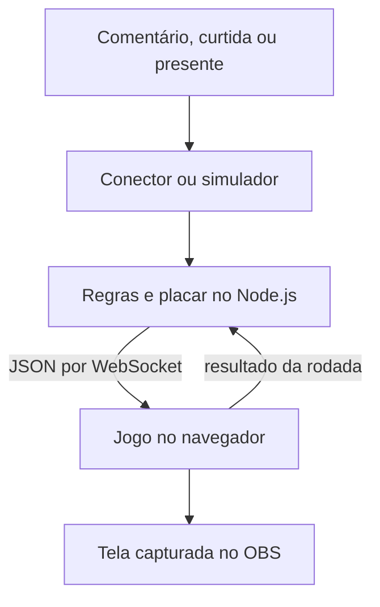

# santi.hub

  <strong>Jogos interativos para lives do TikTok</strong> 
  O público participa com comentários, curtidas e presentes.  
  <a href="https://santiestudio.com.br"><strong>Acessar o site</strong></a> ·
  <a href="https://santiestudio.com.br/#jogos">Ver os jogos</a> ·
  <a href="https://santiestudio.com.br/#planos">Ver os planos</a>

 

## Arquitetura em um olhar

O caminho pontilhado depende do launcher, que ainda não foi criado. O conector de TikTok usa uma biblioteca não oficial e a integração com uma live real ainda não foi validada.

[Abrir a arquitetura detalhada](docs/arquitetura.md)

## Telas

**Abertura do site.** Captura da animação de loading publicada em 23/10/2026.

**Catálogo de jogos.** A página mostra Corrida como disponível e os demais cards com o estado exibido no site naquela data.

[Como as imagens foram obtidas](docs/imagens/ORIGEM.md)

## Índice

- [Sobre o projeto](#sobre-o-projeto)
- [Funcionalidades](#funcionalidades)
- [Tecnologias](#tecnologias)
- [Estado atual](#estado-atual)
- [Documentação](#documentação)
- [Autor e licença](#autor-e-licença)

## Sobre o projeto

O santi.hub oferece uma página de planos, checkout e conta para quem transmite. No jogo, o público escolhe um time comentando seu nome; curtidas e presentes ajudam o último time escolhido. O servidor interpreta esses eventos e envia ações por WebSocket à tela capturada pelo OBS ou LIVE Studio.

O site público anuncia a Corrida como disponível. O repositório privado dos jogos também contém minijogos e um simulador para testar o fluxo sem uma live. Uma tela marcada como “em breve” no site não é apresentada aqui como jogo já lançado.

## Funcionalidades

| Área | O que o código faz |
| --- | --- |
| Planos e checkout | O site calcula o preço no servidor e abre uma sessão Stripe Checkout. |
| Conta e licença | O webhook assinado grava a licença; a API calcula o acesso disponível e pode emitir um ticket assinado. |
| Interação | O servidor transforma comentários, curtidas e presentes em ações de jogo. O simulador percorre esse mesmo caminho. |
| Tela da partida | O navegador recebe ações por WebSocket, atualiza o minijogo e envia o resultado da rodada ao servidor. |
| Reconexão | O conector e o cliente WebSocket tentam restabelecer a conexão; ações perdidas durante a queda não são reproduzidas. |

## Tecnologias

| Parte | Tecnologia | Papel |
| --- | --- | --- |
| Site e API | Next.js, React e TypeScript | Páginas, conta, checkout e webhook |
| Dados da conta | PostgreSQL | Clientes, licenças, sessões e eventos Stripe |
| Pagamento | Stripe | Checkout, assinatura e avisos de pagamento |
| Servidor do jogo | Node.js e TypeScript | Interpretação dos eventos, placar e WebSocket |
| Tela do jogo | Phaser e TypeScript | Rodadas, interface e ações visíveis na transmissão |

## Estado atual

Este repositório é público e contém somente documentação e capturas do sistema. O código do site e o código dos jogos permanecem em repositórios privados separados.

| Parte | Estado |
| --- | --- |
| Página pública | Acessível em [santiestudio.com.br](https://santiestudio.com.br) em 23/10/2026; teste de acesso: `curl -IL --max-time 15 https://santiestudio.com.br` |
| Servidor e tela dos jogos | Testados com o simulador; live real não validada na documentação do projeto |
| Launcher Windows | Ainda não criado |
| Liberação do jogo por licença | Ainda não implementada de ponta a ponta |
| Coleta de eventos TikTok | Conector atual usa `tiktok-live-connector`, biblioteca não oficial |

Tráfego, receita, latência e disponibilidade: **[A MEDIR]**. As capturas mostram interfaces reais, mas não comprovam pagamento concluído nem uso numa live real.

## Documentação

- [Arquitetura](docs/arquitetura.md): componentes, caminho de um evento, estados e reconexão.
- [Modelo de dados](docs/modelo-de-dados.md): tabelas do site e estado dos jogos fora do banco.
- [Fluxo de pagamento](docs/fluxo-pagamento.md): checkout, webhook, licença e falhas.
- [Decisões arquiteturais](docs/adr/): escolhas e consequências observadas no código.

## Autor e licença

[Matheus Guilherme](https://github.com/theuzao). A documentação está sob a [licença MIT](LICENSE).
