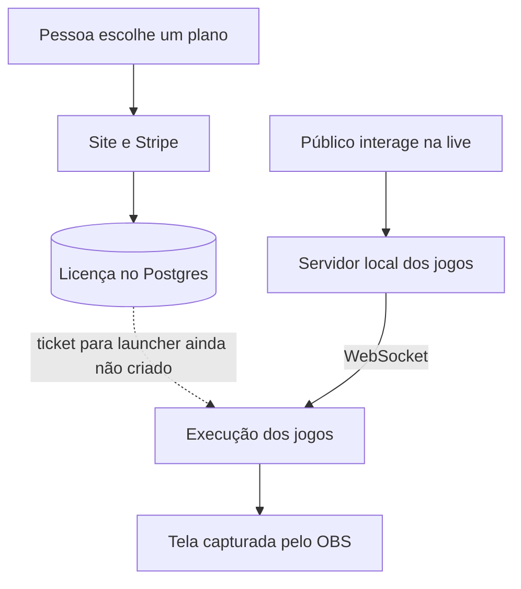

# santi.hub — como o produto funciona

O **santi.hub** reúne uma página de planos, cobrança e licenças com jogos que o público controla durante uma live. Quem transmite coloca a tela do jogo no OBS ou LIVE Studio; quem assiste comenta o nome de um time, curte ou envia presentes; essas interações viram ações visíveis na partida.

O objetivo para quem transmite é transformar a audiência em participantes do jogo. Para quem assiste, a ação é simples: comentar o nome de um time já conta como jogada, e curtidas e presentes ajudam o último time escolhido. O narrador acompanha a rodada e pode avançar ou pausar o jogo.

Durante a transmissão, o jogo alterna entre **Batata Quente, Domina o Mapa, Pescaria e Corrida**. Cada rodada mostra as ações do público na tela; ao terminar, o resultado alimenta um placar geral da live. O vídeo transmitido mostra essa tela, enquanto o servidor local recebe as interações e mantém os times e o placar.

## Dois percursos do produto

| Compra e acesso | Partida na live |
| --- | --- |
| Pessoa escolhe plano no site → Stripe recebe o pagamento → webhook confirmado grava uma licença no Postgres → API informa o acesso disponível. | Live ou simulador produz um evento → servidor Node.js interpreta a interação → WebSocket entrega a ação → jogo no navegador muda a tela → resultado da rodada volta ao servidor. |

**Esses percursos ainda não se encontram na execução:** a API já emite um ticket de licença, mas o launcher Windows que o consumiria ainda não foi criado. O servidor dos jogos analisado não consulta a licença. O site está publicado segundo o autor; o jogo foi validado com simulador, e a documentação do código ainda não registra teste numa live real.

## O que está neste repositório

Este é um **repositório público só de documentação**. O código analisado permanece nos repositórios privados `santi-hub` (site, cobrança, autenticação e API) e `live-jogos` (servidor, simulador e tela). A análise usa, respectivamente, os commits `97ee1f200461bc575f524df66ef363cc9c9e2e8d` e `7e65efb42702b5918d499a85a58c9751de997948`.

- [Arquitetura](docs/arquitetura.md): visão do sistema, contêineres, exemplo de evento, estados e reconexão.
- [Modelo de dados](docs/modelo-de-dados.md): tabelas do site e dados da partida fora do banco.
- [Fluxo de pagamento](docs/fluxo-pagamento.md): confirmação, licença, falha e reenvio do webhook.
- [Decisões arquiteturais](docs/adr/): cinco ADRs ligados ao que foi observado no código.

## Estado e limites

| Parte | Evidência disponível | Limite |
| --- | --- | --- |
| Site, checkout, autenticação e API de licenças | Implementados em `santi-hub`; publicação informada pelo autor | Operação de pagamento real não verificada neste estudo |
| Servidor e tela dos jogos | Código e testes do simulador em `live-jogos` | Live real não validada na documentação do projeto |
| Controle de acesso ao jogo | API emite ticket assinado | Launcher não criado; servidor dos jogos não verifica licença |
| Coleta de eventos TikTok | Conector no código dos jogos | Usa `tiktok-live-connector`, biblioteca **não oficial** |

O conector atual não atende ao requisito futuro do portfólio de coletar conteúdo de usuários apenas por API oficial. Não há métricas medidas de tráfego, receita, latência ou disponibilidade: **[A MEDIR]**.

## Como conferir

Os documentos citam caminhos dos dois repositórios privados e os commits usados na leitura. Este repositório não contém código executável, credenciais ou dados de clientes. Texto e diagramas estão sob [MIT](LICENSE).
