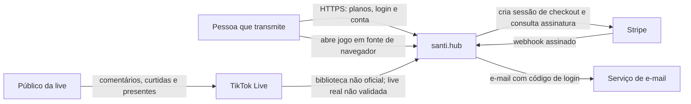
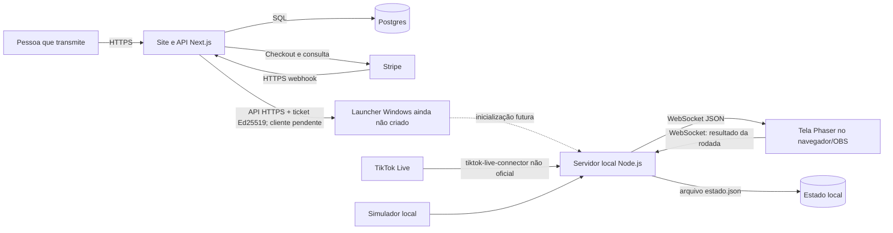

# Arquitetura do santi.hub

**Escopo:** leitura dos commits `santi-hub@97ee1f200461bc575f524df66ef363cc9c9e2e8d` e `live-jogos@7e65efb42702b5918d499a85a58c9751de997948`. Os dois repositórios privados foram identificados pelo autor como partes do mesmo projeto. O launcher ainda não foi criado. Setas pontilhadas representam integração planejada ou não comprovada.

## C4 — nível 1: contexto

O site de planos está publicado segundo o autor. A execução dos jogos numa live real e a ligação da licença à execução ainda não foram comprovadas. O diagrama representa o sistema pretendido e o caminho implementado no simulador, com esse limite explícito.

## C4 — nível 2: contêineres

O site e a API contêm checkout, webhook, autenticação por código, sessões e emissão de ticket. O contrato da API do launcher existe em `santi-hub/docs/api-launcher.md`, mas seu cliente Windows não existe. O servidor dos jogos e a tela são outra aplicação; o código analisado não mostra verificação de licença pelo servidor de jogos.

## Caminho de um evento até a tela

1. `server/src/conector/tiktok.ts` recebe eventos `CHAT`, `GIFT` e `LIKE` por `tiktok-live-connector`. Esse conector **não é API oficial** e não consta teste numa live real. O simulador em `server/src/conector/simulador.ts` produz o mesmo `EventoLive` para ensaio.
2. Comentários são convertidos em texto e usuário; presentes em nome, quantidade e moedas; curtidas em quantidade. `ContadorCombo` calcula apenas a diferença do `repeatCount` cumulativo para um combo.
3. `server/src/pipeline.ts` interpreta o comentário, associa a pessoa ao último time escolhido, limita comentários que viram jogada a um por pessoa por segundo e encaminha a ação. Curtidas sem time são ignoradas; presente sem time aparece como aviso, sem agir no jogo.
4. `server/src/ws.ts` transmite `{t:"acao", acao}` em JSON por WebSocket local. `game/src/core/rede.ts` recebe e emite o evento para `game/src/core/rotacao.ts`, que mostra o aviso e chama `onAcao` no minijogo ativo.
5. No fim da rodada, `rotacao.ts` envia `{t:"resultado", resultado}`. O servidor valida o formato, registra pontos no `Placar` e retransmite um snapshot. Dois resultados recebidos com menos de 20 segundos entre si são tratados como duplicados; isso é uma janela temporal, não uma chave de rodada.

**Dois presentes no mesmo milissegundo:** o pipeline processa as chamadas recebidas pelo processo Node.js em sequência; presentes não passam pelo limite de comentários. Ambos podem produzir ações. Para eventos de um mesmo combo, `ContadorCombo` usa a diferença do contador cumulativo. O código não oferece chave persistente para deduplicar reentregas arbitrárias após reinício nem ordenação global de eventos.

## Onde fica o estado

| Estado | Local | Persistência e limite |
| --- | --- | --- |
| Times, pontos do campeonato, ranking de presentes e número de rodadas | `Placar` em memória no servidor | Snapshot em `dados/estado.json`, agendado para 300 ms após mudança. Erro de gravação é registrado no log. |
| Fase, cronômetro, jogo ativo e pontuação da rodada atual | `Rotacao` e cena do minijogo no navegador | Não há restauração da rodada após recarga da página. |
| Último comentário por usuário para limite de jogadas | `Map` em memória no pipeline | Reinício zera o limite. |
| Contagem dos combos de presentes | `Map` em memória no conector | Entrada expira após 60 s; reinício perde histórico. |
| Clientes, licenças, sessões, códigos de login e eventos Stripe | Postgres do site | Esquema e restrições em `santi-hub/db/migracoes/`. |

## Queda e reconexão

- **TikTok → servidor:** em desconexão ou fim de live, o conector agenda nova tentativa com espera que dobra de 5 s até 60 s. O simulador continua disponível. Não há fila durável nem recuperação demonstrada dos eventos perdidos durante a queda.
- **Servidor → tela:** o cliente WebSocket tenta reconectar após 2 s. O jogo continua rodando localmente. Na conexão, o servidor manda o snapshot do placar geral; ações perdidas não são reenviadas. Um resultado enviado enquanto o socket está fechado é perdido.
- **Reinício do servidor:** `Placar` carrega `estado.json`, se legível. O estado da rodada no navegador não é sincronizado com esse arquivo.
- **Recarga da tela:** inicia uma nova rotação local e recebe o placar geral. Não retoma a rodada anterior.

## Evidência e lacunas

O fluxo do simulador tem testes no servidor (`server/src/regras.test.ts`). O próprio `live-jogos/ARQUITETURA.md` declara que o conjunto ainda não foi testado numa live real. A captura de conteúdo da live depende de biblioteca não oficial; não se deve apresentar esta integração como aderente à regra de usar somente API oficial. Latência ponta a ponta, perda em reconexão e carga suportada: **[A MEDIR]**.
