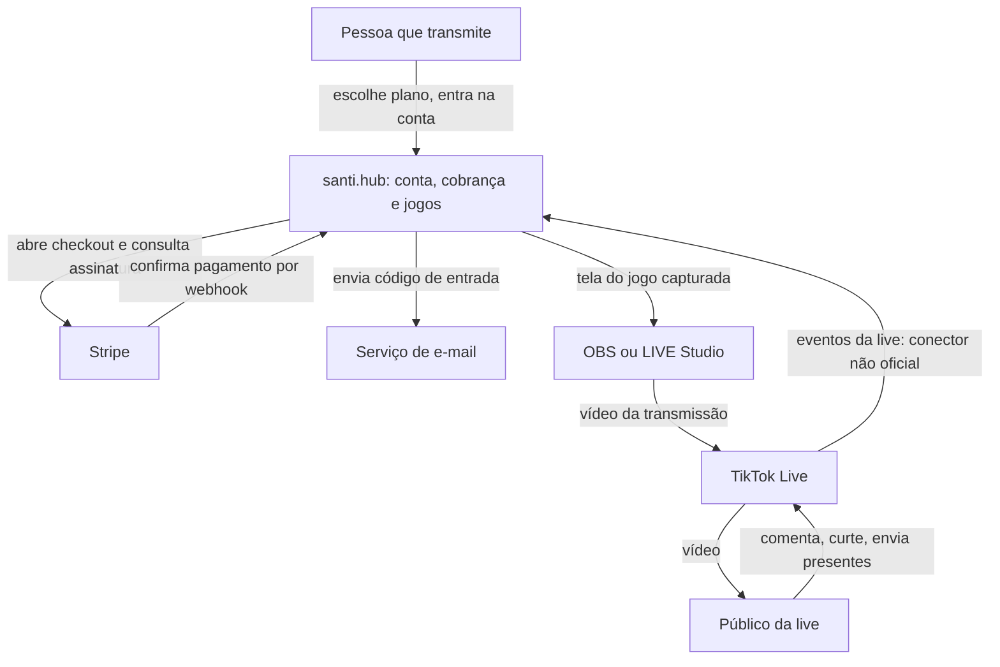
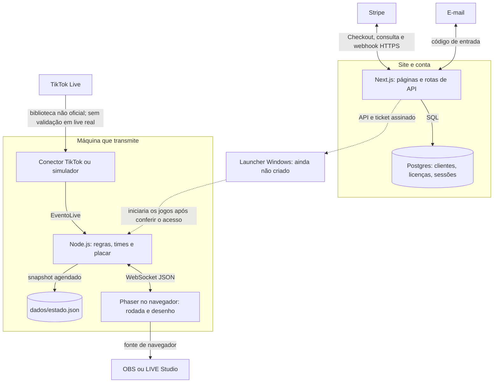
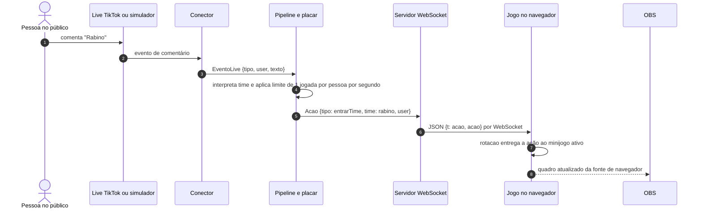
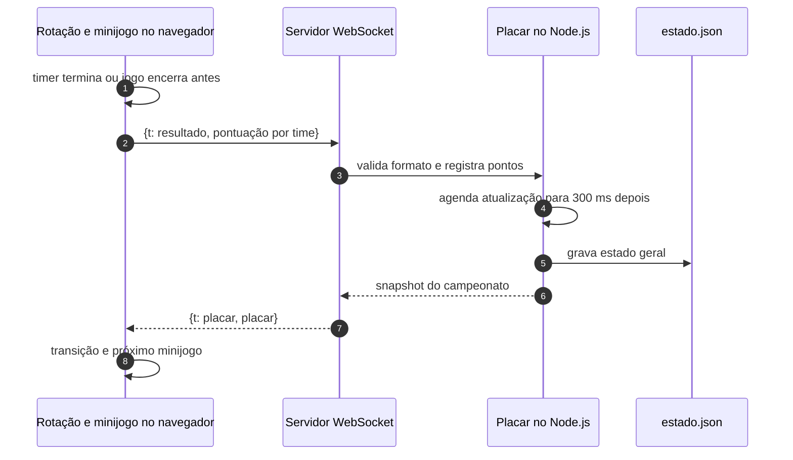
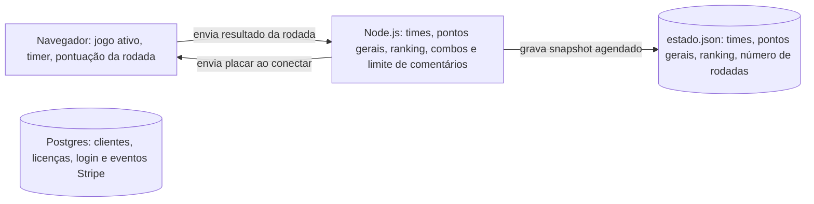
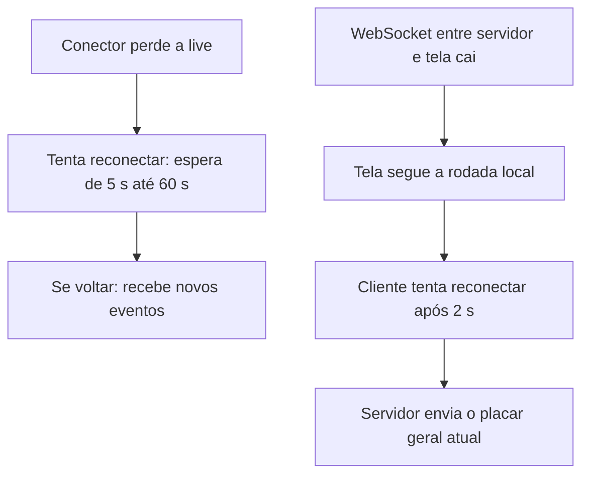

# Arquitetura do santi.hub

O produto tem **um lado de conta e pagamento** e **um lado de jogo em tempo real**. O primeiro administra quem teria acesso; o segundo recebe interações da live e desenha a partida. O launcher que ligaria os dois lados ainda não foi criado. Os diagramas abaixo separam fluxo implementado de integração pendente.

**Fonte da leitura:** `santi-hub@97ee1f200461bc575f524df66ef363cc9c9e2e8d` e `live-jogos@7e65efb42702b5918d499a85a58c9751de997948`, repositórios privados que o autor identificou como partes do projeto. Linha contínua indica caminho presente no código; linha pontilhada indica ligação ainda sem implementação ponta a ponta.

## 1. Quem interage com o sistema — C4 nível 1

A linha TikTok → santi.hub existe no conector, mas o repositório de jogos declara que ainda não foi testada numa live real. O site publicado foi informado pelo autor; este estudo não mediu operação em produção.

## 2. Onde cada parte roda — C4 nível 2

Os vínculos pontilhados representam a integração prevista. A API do site emite um ticket que um launcher futuro consumiria; esse cliente iniciaria os jogos após verificar o acesso. Como o launcher não existe e o servidor de jogos não confere licença, os dois blocos devem ser explicados separadamente numa entrevista.

## 3. Um comentário que vira jogada

Exemplo concreto: uma pessoa comenta **“Rabino”**. O simulador permite percorrer o mesmo pipeline sem entrar numa live.

*Tela do jogo capturada no simulador. [Origem da imagem](imagens/ORIGEM.md).*

**Arquivos que sustentam as setas:** `server/src/conector/tiktok.ts` ou `simulador.ts` → `server/src/pipeline.ts` → `server/src/ws.ts` → `game/src/core/rede.ts` → `game/src/core/rotacao.ts` → cena do minijogo. O tipo comum de mensagem fica em `shared/protocolo.ts`.

Curtidas são atribuídas ao último time comentado pela pessoa. Presentes também; quando ela ainda não escolheu time, o presente aparece como aviso e não age no jogo. Para presentes em combo, `ContadorCombo` calcula o aumento do `repeatCount` cumulativo antes de criar a ação. Dois presentes independentes recebidos no mesmo milissegundo são processados em sequência no processo Node.js: o limite de um segundo vale para **comentários que viram jogada**, não para presentes. O código não oferece ordenação global nem deduplicação durável de todas as entregas da live.

## 4. O fechamento de uma rodada

O servidor ignora um segundo resultado recebido em menos de 20 segundos. Essa janela tenta evitar dupla contagem quando OBS e aba de teste estão abertos, mas não identifica uma rodada por ID; pode ignorar uma segunda rodada legítima muito próxima ou aceitar duplicação tardia.

## 5. Quem guarda cada estado

| Onde | O que acontece numa queda |
| --- | --- |
| Navegador | O jogo segue seu cronômetro durante perda do WebSocket; recarregar a página reinicia a rodada. O resultado enviado offline é perdido. |
| Processo Node.js | Times e placar geral são carregados de `estado.json` após reinício, se o arquivo estiver legível. Mapas de combos e limite de comentários não são restaurados. |
| Arquivo local | A gravação é agendada para 300 ms após a primeira mudança pendente; uma queda antes da gravação pode perder mudanças. `ultimaRodada` não é gravada. |
| Postgres | Mantém conta, licença, sessões, códigos de login e webhooks Stripe; não guarda ações ou rodadas dos jogos. |

## 6. Quando uma conexão cai

Não existe fila durável nem reenvio de ações perdidas. O simulador permanece disponível se a conexão com TikTok cair. Reconectar o WebSocket recupera o placar geral, mas não reconstrói a rodada da tela.

## Evidência e pendências

Os testes do servidor cobrem combo, regras de comentário, pontos e pipeline com simulador (`server/src/regras.test.ts`). O repositório `live-jogos` declara que ainda não houve validação numa live real. O conector usa `tiktok-live-connector`, biblioteca não oficial; por isso essa coleta não pode ser apresentada como uso de API oficial. Latência ponta a ponta, perda em reconexão e carga suportada: **[A MEDIR]**.
