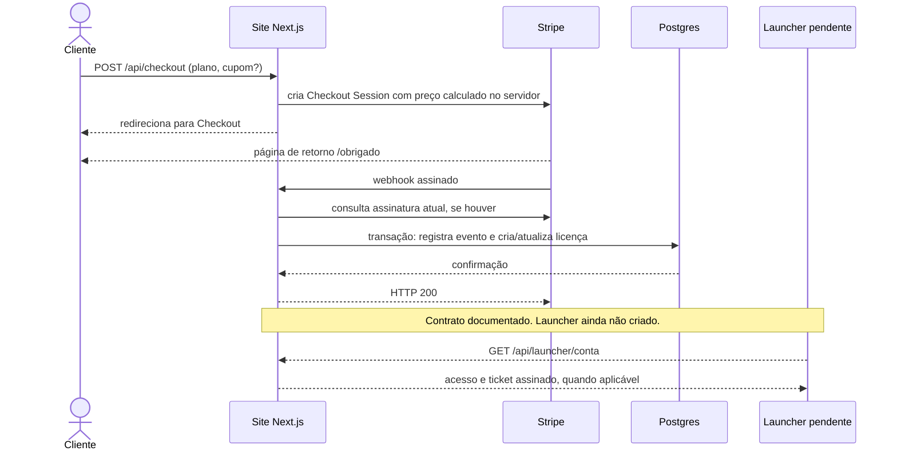

# Do checkout ao acesso

Fonte: `santi-hub/app/api/checkout/route.ts`, `app/api/stripe/webhook/route.ts`, `lib/licencas.ts`, `lib/conta.ts`, `lib/api-launcher.ts`, `lib/ticket.ts` e migrações do banco.

O fluxo começa na [seção de planos do site](https://santiestudio.com.br/#planos). Os preços atuais devem ser conferidos lá.

1. O formulário envia um identificador de plano. O servidor calcula modo e preço; não aceita valor monetário do navegador. A Stripe hospeda o Checkout. Os métodos de pagamento disponíveis dependem da configuração na Stripe.
2. A página `/obrigado` é uma página de retorno. **A liberação não depende dela:** depende do webhook validado e da licença gravada no banco. Se o retorno chegar antes do webhook, a licença pode ainda não aparecer na conta.
3. `/api/stripe/webhook` confere a assinatura do corpo cru. Sem configuração ou com assinatura inválida, responde 400. Eventos tratados: checkout concluído, pagamento assíncrono confirmado, atualização ou remoção de assinatura e reembolso.
4. Para assinaturas, o servidor relê o estado atual na Stripe antes da transação, evitando aplicar estado antigo de um evento fora de ordem. Na transação, grava `eventos_stripe.id` com chave única e só então altera licença e auditoria. Reenvio do mesmo evento resulta em `repetido`.
5. `checkout.session.completed` só cria licença se o estado de pagamento for `paid` ou `no_payment_required`. Pagamento assíncrono pendente aguarda `checkout.session.async_payment_succeeded`. Sessão sem plano, e-mail, cliente ou modo coerente gera auditoria `stripe.sessao_invalida`, sem licença.
6. A API calcula o acesso a partir das licenças: plano gratuito `treino`; compra única `largada`; assinatura válida `hub`. Uma assinatura atrasada conserva acesso durante a carência codificada de três dias após `valida_ate`. Cancelada ou reembolsada não é válida.
7. O contrato do launcher prevê login por código, consulta à conta e um ticket Ed25519 de 24 horas, emitido apenas para plano pago com @ TikTok definido. A documentação da API prevê que o launcher confira assinatura, validade e @ da live. **O launcher não foi criado; esta verificação ainda não é comportamento executável demonstrado.** O servidor dos jogos analisado também não verifica esse ticket.

## Se o webhook falhar

Se a função lançar erro durante o processamento, a rota responde 500. A transação do banco desfaz as gravações daquele evento, inclusive o registro de deduplicação, permitindo uma nova tentativa. O comentário no código afirma que a Stripe tenta reenviar por até três dias; esse prazo é uma expectativa registrada no código, **não foi medido nem validado neste estudo**. Se a falha persistir ou a configuração do endpoint estiver errada, a licença pode não ser criada automaticamente. Não há reconciliação periódica implementada no código analisado; exige diagnóstico e correção operacional.

## Limites e verificações pendentes

- Um resultado `200` do webhook significa que o evento foi aceito ou ignorado conforme o tipo, não que a tela do jogo recebeu acesso.
- Duplicação é tratada por `eventos_stripe.id` e pela unicidade de `stripe_checkout_session_id`. Não há demonstração de pagamento real neste repositório.
- Tempo do checkout até o acesso, taxa de falhas de webhook e volume de compras: **[A MEDIR]**.
