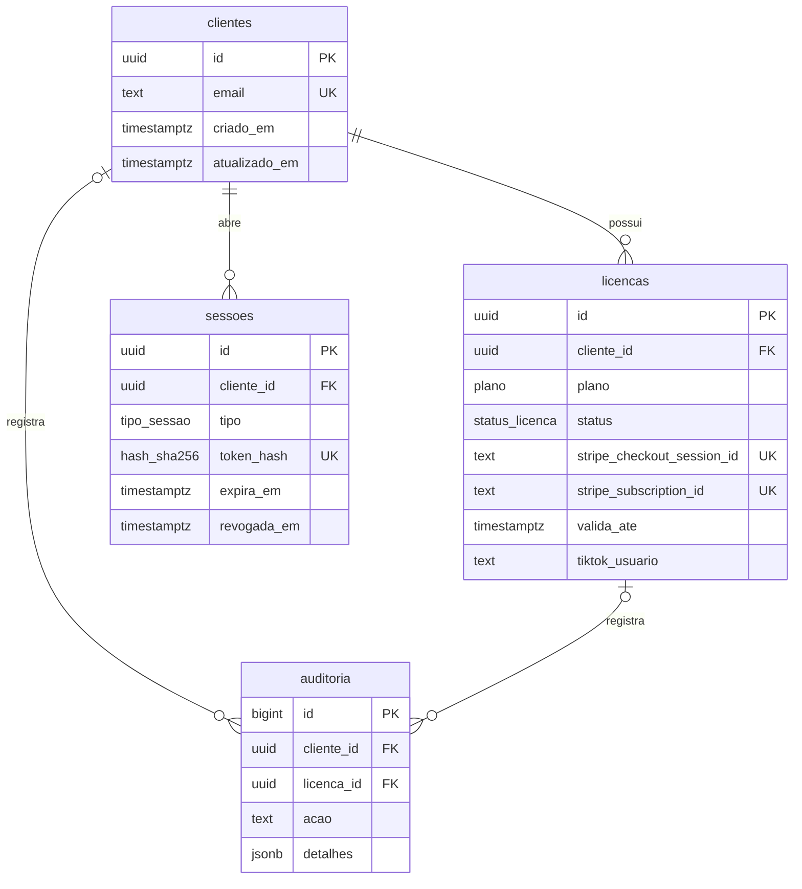

# Modelo de dados

Fonte: migrações `santi-hub/db/migracoes/001_licencas.sql` e `002_login.sql` no commit `97ee1f200461bc575f524df66ef363cc9c9e2e8d`; tipos e estado de `live-jogos/shared/protocolo.ts` e `server/src/estado/placar.ts` no commit `7e65efb42702b5918d499a85a58c9751de997948`.

## Relacionamentos persistidos no Postgres

`eventos_stripe`, `codigos_login` e `limites` são tabelas sem chave estrangeira para `clientes`; são ligadas por identificador do evento, e-mail ou chave de limite conforme a função. Não foi inferida uma relação que o banco não impõe.

## Dicionário das tabelas

| Tabela | Campos e função | Regras relevantes |
| --- | --- | --- |
| `santi.clientes` | `id` UUID; `email` normalizado; `criado_em`, `atualizado_em` | E-mail único, minúsculo e sem espaços laterais. |
| `santi.licencas` | `id`, `cliente_id`, `plano` (`largada`, `mensal`, `anual`), `status` (`ativa`, `atrasada`, `cancelada`, `reembolsada`), `stripe_customer_id`, `stripe_checkout_session_id`, `stripe_subscription_id`, `stripe_payment_intent_id`, `valida_ate`, `cancela_no_fim`, `tiktok_usuario`, `tiktok_definido_em`, timestamps | Uma linha por checkout. Checkout único; assinatura e pagamento únicos quando presentes. `largada` não vence; planos recorrentes exigem assinatura e vencimento. Dados da origem da compra são imutáveis. |
| `santi.eventos_stripe` | `id` do evento, `tipo`, `recebido_em` | `id` é chave primária; protege contra reprocessamento do mesmo webhook. |
| `santi.auditoria` | `id`, `cliente_id?`, `licenca_id?`, `acao`, `detalhes` JSON, `ip?`, `em` | Aceita apenas inserção; chaves de cliente e licença podem ser nulas para eventos sem vínculo válido. |
| `santi.codigos_login` | `id`, `email`, `codigo_hash`, `tentativas`, `criado_em`, `expira_em`, `usado_em?`, `ip?` | Código guardado como hash; validade limitada, uso único e até cinco tentativas. |
| `santi.sessoes` | `id`, `cliente_id`, `tipo` (`web`, `launcher`), `token_hash`, `dispositivo?`, `ip?`, `criada_em`, `ultimo_uso_em`, `expira_em`, `revogada_em?` | Token guardado como SHA-256; sessão pode ser usada ou revogada, sem trocar dono nem prolongar vencimento. |
| `santi.limites` | `chave`, `janela`, `contagem` | Chave composta `(chave, janela)` para limite de uso em janela fixa. |

`?` indica coluna que aceita nulo. Os campos Stripe e TikTok são dados operacionais, não métricas públicas de clientes. Nenhum registro real foi copiado para este repositório.

## Estado dos jogos fora do banco

O servidor de jogos não usa essas tabelas. A classe `Placar` guarda em memória `membros` (usuário → time), `pontos` (time → total), `presenteadores` (usuário → moedas e time) e `rodadas` (contagem). Ela agenda a gravação desses campos em `dados/estado.json` para 300 ms após a primeira mudança pendente. `ultimaRodada` aparece no snapshot transmitido, mas não integra a estrutura gravada; após reinício, ela volta vazia.

O navegador guarda `fase`, `restante`, `indice` do jogo e pontuação da rodada em memória. São estruturas de execução, sem entidade relacional correspondente. `EventoLive` e as mensagens WebSocket são contratos transitórios; não há tabela de eventos de audiência nem histórico durável de ações da partida.
